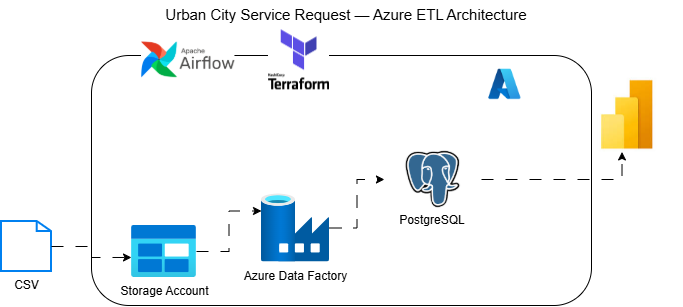

# Urban City Service Request Data Platform

A production-style data engineering project that ingests urban service-request data, transforms it into analytics-ready Parquet, loads it into PostgreSQL, and orchestrates the workflow with Apache Airflow and Azure Data Factory.

## Project Overview

This project demonstrates an end-to-end batch data platform for urban service-request analytics.

The platform combines local Python-based transformation with Azure cloud services, Terraform infrastructure-as-code, Airflow orchestration, PostgreSQL, and an analytics-ready star schema.

The main goals are to demonstrate:

- Cloud data ingestion and storage
- Bronze and Silver data-layer design
- Data cleansing and validation with Polars
- Infrastructure as Code with Terraform
- Azure Data Factory integration
- PostgreSQL staging and dimensional modelling
- Airflow orchestration
- Secure handling of configuration and credentials
- A clear path to Power BI analytics

## Architecture


## Data Flow

1. A raw CSV file is uploaded to Azure Blob Storage Bronze.
2. The raw data is read from Bronze using Polars.
3. The transformation process cleans column names, dates, text fields, status values, and geographic fields.
4. The transformed dataset is validated.
5. The validated dataset is written to Azure Silver as Parquet.
6. Airflow triggers the Azure Data Factory `PL_Silver_To_Gold` pipeline.
7. ADF copies Silver data into PostgreSQL staging.
8. SQL transformations populate the Gold dimensional model.
9. Power BI can consume the Gold layer for reporting and analytics.

## Technology Stack

| Area | Technology |
|---|---|
| Language | Python |
| Transformation | Polars |
| Orchestration | Apache Airflow |
| Cloud | Microsoft Azure |
| Object Storage | Azure Blob Storage |
| Data Integration | Azure Data Factory |
| Database | PostgreSQL 16 |
| Infrastructure as Code | Terraform |
| Terraform API extensions | AzAPI |
| Analytics | Power BI |
| Containerisation | Docker |
| Version Control | Git / GitHub |

## Data Layers

### Bronze

The Bronze layer stores the raw source CSV with minimal modification.

Purpose:

- Preserve source data
- Support reproducibility
- Provide a source-of-truth landing layer

### Silver

The Silver layer contains cleaned and validated Parquet data.

Current Silver fields include:

```text
request_id
created_date
closed_date
agency
problem
problem_detail
location_type
incident_address
city
borough
status
latitude
longitude
```

### Gold

The Gold layer is designed for analytics using a dimensional model.

Current model:

```text
gold.dim_date
gold.dim_agency
gold.dim_problem
gold.dim_location
gold.fact_service_request
```

## Data Quality Checks

The transformation layer performs validation including:

- Required column checks
- Request ID uniqueness and non-null validation
- Valid status validation
- Created-date validation
- Status / closed-date consistency checks
- Latitude and longitude range checks
- Row-count validation
- Exact Silver-column validation

## Airflow

Airflow is used as the orchestration layer.

The DAG follows the intended workflow:

```text
extract_data_from_csv
        |
        v
transform_data
        |
        v
run_adf_pipeline
```

The final task uses the Azure Data Factory operator to trigger:

```text
PL_Silver_To_Gold
```

The ADF pipeline then handles the Silver-to-PostgreSQL processing.

## Azure Data Factory

The project uses Azure Data Factory for the Silver-to-Gold loading stage.

The working ADF pipeline contains the following logical stages:

```text
Copy Silver → PostgreSQL Staging
              |
              v
        Load dim_agency
              |
              v
        Load dim_problem
              |
              v
        Load dim_location
              |
              v
        Load dim_date
              |
              v
        Load fact_service_request
```

The project also demonstrates the use of the PostgreSQL V2 connector and a Terraform-managed ADF linked service.

## Terraform

Terraform provisions the Azure foundation for the project.

Managed resources include:

- Resource Group
- Storage Account
- Bronze container
- Silver container
- PostgreSQL Flexible Server
- PostgreSQL database
- PostgreSQL firewall rule
- Azure Data Factory
- Azure Blob linked service
- Silver Parquet dataset
- PostgreSQL linked service
- PostgreSQL dataset

AzAPI is used where the AzureRM provider does not provide the required current ADF PostgreSQL connector functionality.

### Terraform structure

```text
terraform/
├── main.tf
├── variables.tf
├── secrets.tfvars      # local only - do not commit
└── notes.md             # local/project notes
```


## Local Setup

### 1. Clone the repository

```bash
git clone <YOUR-GITHUB-URL>
cd urban-city-service-request-data-platform
```

### 2. Create a Python environment

```bash
python -m venv .venv
source .venv/Scripts/activate
```

On Windows Git Bash, the activation command above can be used when the virtual environment was created with standard Python.

### 3. Install dependencies

```bash
pip install -r requirements.txt
```

### 4. Configure environment variables

Create a local `.env` file for secrets such as the Azure Storage account key.

Example:

```env
ACCOUNT_KEY=<your-storage-account-key>
```

Do not commit `.env`, passwords, subscription credentials, client secrets, or Terraform variable files containing secrets.

## Run the Transformation Locally

From the repository root:

```bash
python -m scripts.transform
```

The transformation reads Bronze data and writes the validated Silver Parquet dataset.

## Terraform Commands

From the `terraform/` directory:

```bash
terraform init
terraform fmt
terraform validate
terraform plan
terraform apply
```

Review the plan carefully before applying infrastructure changes.

## Security

Sensitive values are kept outside source control.

The repository should never contain:

```text
.env
credentials.txt
terraform.tfstate
terraform.tfstate.backup
secrets.tfvars
Azure client secrets
PostgreSQL passwords
```

Use environment variables or local secret files for development credentials and keep them ignored by Git.

## Current Status

Completed project capabilities include:

- Azure Bronze and Silver storage
- Polars transformation and validation
- PostgreSQL Flexible Server provisioning with Terraform
- Azure Data Factory provisioning with Terraform
- PostgreSQL V2 ADF connectivity
- Airflow DAG orchestration
- Airflow-to-ADF pipeline triggering
- Bronze → Silver → PostgreSQL data flow design
- Gold star-schema loading design

The next infrastructure milestone is to fully manage the complete `PL_Silver_To_Gold` ADF pipeline definition through Terraform/AzAPI, rather than relying on the manually authored Azure pipeline as the reference implementation.

## Why This Project Matters

This project demonstrates the practical skills required to build a modern cloud data platform:

- ingestion
- transformation
- data quality
- cloud storage
- orchestration
- infrastructure as code
- relational data modelling
- cloud data integration
- analytics readiness

It is designed as a portfolio project to show how these components work together in an end-to-end data engineering workflow.

## Author

**Chukwuemeka Nwankwo**

Data Engineering | Python | SQL | Azure | Airflow | Terraform | PostgreSQL | Power BI
